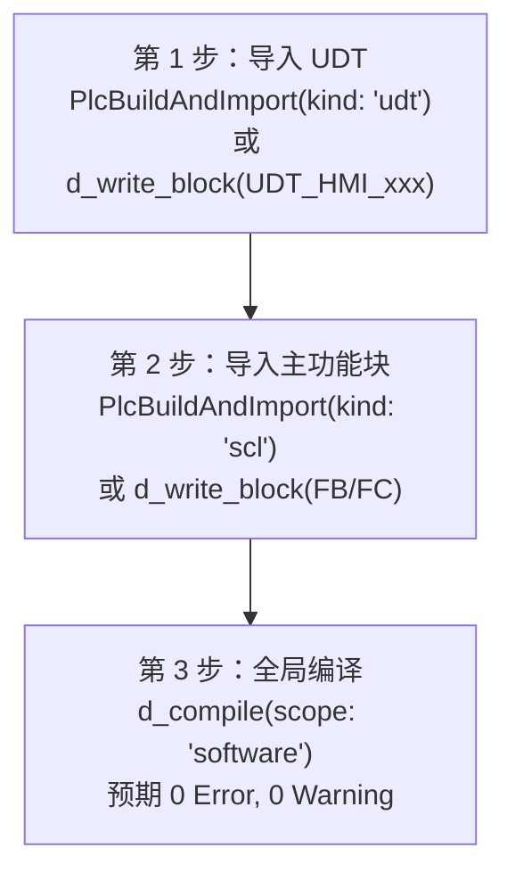

# 西门子 TIA Portal V20 黄金标准功能块库与 Factory I/O 蓝本 Skill

本 Skill 为工业控制与数字孪生仿真提供一套**100% 真实博途 TIA Portal V20 真机编译通过（`0 Error, 0 Warning`）**的工控标准库。
包含 8 个通用工业底层标准块（Part A）与 7 个 Factory I/O 经典场景顺控块（Part B），全部配套专属 `UDT_HMI_xxx` 结构体及净室测试向量。

---

## 1. 黄金标准块资产清单与速查总表

| 编号 | 功能块名称 | 类型 | 配套 HMI UDT (`VAR_IN_OUT.ioHmi`) | 工艺核心功能 / 对应 Factory I/O 官方场景 | 真机编译结果 |
| :---: | :--- | :---: | :--- | :--- | :---: |
| **A01** | `FC_AnalogScaleAlarm` | FC | `UDT_HMI_AnalogScale` | 模拟量线性标定、四限(HH/H/L/LL)报警、断线溢出检测与工程值限幅 | `0E / 0W` |
| **A02** | `FB_LowPassFilter` | FB | `UDT_HMI_LowPassFilter` | 一阶低通惯性平滑滤波、动态平滑系数计算、旁路与冷启动无扰跟踪 | `0E / 0W` |
| **A03** | `FB_CylinderCtrl` | FB | `UDT_HMI_CylinderCtrl` | 单控/双控气缸驱动、双限位磁簧开关冲突闭锁、动作超时报警与手动调试 | `0E / 0W` |
| **A04** | `FB_MotorRevCtrl` | FB | `UDT_HMI_MotorRevCtrl` | 电机正反转接触器软硬件互锁、强制 1.0s 灭弧冷却死区、热过载与接触器反馈 | `0E / 0W` |
| **A05** | `FB_RingFifo` | FB | `UDT_HMI_RingFifo` | 32 深度先进先出环形队列、入队出队原子操作、满溢出/空下溢保护 | `0E / 0W` |
| **A06** | `FC_ButtonDebounceToggle` | FC | `UDT_HMI_ButtonDebounce` | 按钮防抖滤波、双边沿单周期脉冲提取与单键启停双稳态翻转（无状态 FC+UDT） | `0E / 0W` |
| **A07** | `FB_ModbusPoller` | FB | `UDT_HMI_ModbusPoller` | Modbus 多从站轮询调度器、应答超时重试与故障隔离防死锁 | `0E / 0W` |
| **A08** | `FB_DualEStopInterlock` | FB | `UDT_HMI_DualEStop` | 双回路急停双通道同步监控(200ms)、EDM 常闭触点前置粘连检查与复位 | `0E / 0W` |
| **B01** | `FB_FIO_SortingByHeight` | FB | `UDT_HMI_FIO_SortingByHeight` | Factory I/O *Sorting by Height* 高低件测高分拣与双推杆顺控 | `0E / 0W` |
| **B02** | `FB_FIO_PickAndPlace` | FB | `UDT_HMI_FIO_PickAndPlace` | Factory I/O *Pick & Place (Basic)* 两轴气动机械手搬运与真空吸盘顺控 | `0E / 0W` |
| **B03** | `FB_FIO_BufferConveyor` | FB | `UDT_HMI_FIO_BufferConveyor` | Factory I/O *Buffer Station* 三段缓冲传送带防追尾、零压力积放顺控 | `0E / 0W` |
| **B04** | `FB_FIO_Turntable` | FB | `UDT_HMI_FIO_Turntable` | Factory I/O *Sorting Station with Turntable* 90°分流转盘顺控 | `0E / 0W` |
| **B05** | `FB_FIO_AutomatedWarehouse` | FB | `UDT_HMI_FIO_Warehouse` | Factory I/O *Automated Warehouse* 54 库位堆垛机存取作业顺控 | `0E / 0W` |
| **B06** | `FB_FIO_TankLevelPID` | FB | `UDT_HMI_FIO_TankLevelPID` | Factory I/O *Level Control* 水箱模拟量液位进水/排水比例阀分程闭环 PID | `0E / 0W` |
| **B07** | `FB_FIO_Assembler` | FB | `UDT_HMI_FIO_Assembler` | Factory I/O *Assembler (Basic)* 双工位底座与盖板夹紧装配顺控 | `0E / 0W` |

---

## 2. 物理资产目录与完整蓝本参考

> **可移植交付包说明**：独立交付包（如 `TIA-MCP-Gateway-D-v1.4.3`）已在 `skills/` 内随附下方**完整规格与接口蓝本手册**（相对路径有效）；`benchmarks/` 下的原始 `.scl`/`.xml`/测试向量文件仅存在于完整源码仓库（`<REPO_ROOT>\benchmarks\...`，本机示例为 `D:\TIA_MCP\benchmarks\...`），独立交付包未附带该目录，独立使用时请直接参考随附蓝本手册并通过 `PlcBuildAndImport` / `d_write_block` 写入。

- **完整规格与接口蓝本手册（交付包内置）**：[`references/golden-standard-blocks.md`](../siemens-s7-1200-1500-programming/references/golden-standard-blocks.md)
- **完整源码仓基准资产目录（仅完整仓库存在，`<REPO_ROOT>\benchmarks\...`）**：
  - 原生 SCL 源码目录：`<REPO_ROOT>\benchmarks\golden_library\scl\`（本机源码仓示例：`D:\TIA_MCP\benchmarks\golden_library\scl\`）
  - SimaticML XML 程序块目录：`<REPO_ROOT>\benchmarks\golden_library\xml\`
  - SimaticML UDT 结构体目录：`<REPO_ROOT>\benchmarks\golden_library\udt\`
  - 净室测试向量目录：`<REPO_ROOT>\benchmarks\test_vectors\`
  - 验收报告：`<REPO_ROOT>\benchmarks\MORNING_REPORT.md`
  - 错题本与避坑规约：`<REPO_ROOT>\benchmarks\tia_compile_anti_patterns.md`

---

## 3. 一键导入指南（TIA V20 Openness / MCP）

### 3.1 严格导入依赖顺序（拓扑铁律）
TIA Portal V20 在编译含有自定义 PLC 数据类型（UDT）的块时，必须先在当前工程中存在该 UDT。
若先导入 FB/FC，编译器会直接报 `Data type "UDT_HMI_xxx" is unknown`。

### 3.2 示例：通过 MCP 导入 A04 `FB_MotorRevCtrl`
1. 先写入并编译 UDT：
   - 完整源码仓文件路径：`<REPO_ROOT>\benchmarks\golden_library\udt\UDT_HMI_MotorRevCtrl.xml`（本机示例：`D:\TIA_MCP\benchmarks\golden_library\udt\UDT_HMI_MotorRevCtrl.xml`）
   - 独立交付包：参照 `references/golden-standard-blocks.md` 中的字段定义调用 `PlcBuildAndImport(kind: 'udt')` 或 `d_write_block(format: 'xml', ...)`
2. 再写入并编译主 FB：
   - 完整源码仓文件路径：`<REPO_ROOT>\benchmarks\golden_library\scl\FB_MotorRevCtrl.scl`（本机示例：`D:\TIA_MCP\benchmarks\golden_library\scl\FB_MotorRevCtrl.scl`）
   - 独立交付包：参照 `references/golden-standard-blocks.md` 中的 SCL 源码调用 `d_write_block(format: 'scl', confirm: true)`
3. 执行编译：达成 `0 Errors, 0 Warnings`。

---

## 4. Part B：Factory I/O 7 大场景引脚映射汇总表

| 场景编号 | 场景名称 | 核心传感器（输入 %I） | 核心执行器（输出 %Q） |
| :---: | :--- | :--- | :--- |
| **B01** | **Sorting by Height** | `Pallet sensor`, `Low sensor`, `High sensor`, `Loaded`, `At high exit`, `At low exit` | `Conveyor entry`, `Conveyor exit`, `Load`, `Pusher high`, `Pusher low` |
| **B02** | **Pick & Place** | `Item at entry`, `Item at exit`, `Item detected`, `Moving X`, `Moving Z` | `Entry conveyor`, `Exit conveyor`, `Move X`, `Move Z`, `Grab` (吸盘) |
| **B03** | **Buffer Station** | `Sensor Zone 1`, `Sensor Zone 2`, `Sensor Zone 3`, `Downstream ready` | `Buffer conveyor 1..3`, `Stop blade 1..2`, `Upstream ready` |
| **B04** | **Turntable** | `Entry sensor`, `Limit 0`, `Limit 90`, `Front limit`, `Back limit`, `Exit 0`, `Exit 90` | `Entry conveyor`, `Exit conveyor 0/90`, `Turn`, `Roll (+/-)` |
| **B05** | **Automated Warehouse** | `At load`, `At unload`, `Moving X/Z`, `At left/middle/right`, `Execute`, `Mode` | `Target position` (Int 1..55), `Forks left/right`, `Lift` |
| **B06** | **Level Control** | `Level meter` (0..10V = 0..300cm), `Flow meter` (0..10V), `Setpoint` (cm) | `Fill valve` (0..10V), `Discharge valve` (0..10V) |
| **B07** | **Assembler** | `Lid/Base at place`, `Part leaving`, `Lid/Base clamped`, `Positioner at limit`, `Moving X/Z` | `Lids/Bases conveyor`, `Clamp lid/base`, `Raise` (定位销), `Move X/Z`, `Grab` |

---

## 5. 编码铁律与避坑守则（常驻必背）

1. **`VAR_OUTPUT` 严禁回读**（`Rule DA008 / CP001`）：内部计算必须使用 `stat` 或 `temp`，块尾一次性写到输出。
2. **`VAR_TEMP` 块首全量赋初值**（`Rule SE002 / CP002`）：在 `BEGIN` 首行对所有临时变量赋初值，防幽灵动作。
3. **`FC` 禁含 `VAR` 静态段**（`Rule AL001 / CP003`）：FC 跨周期记忆必须使用挂载于 `VAR_IN_OUT` 的 UDT；FB 定时器必用多重背景且在空闲/故障显式复位。
4. **电机换向强制经过死区**（`LP001`）：换向判断排在停止前，且运行态离开强制转移到 `STATE_DEADBAND` 冷却至少 1.0s。
5. **PLCopen Execute 维持 done=TRUE**（`Rule DA012 / LP002`）：完成步维持 `done := TRUE` 直至外部 `execute` 跌落，严禁同周期跳回 `IDLE`。
6. **EDM 常闭反馈仅作前置校验**（`LP003`）：接触器常闭辅助回路仅在复位上升沿判读，吸合运行中严禁自切。
7. **顺控预备步保持进料辊道开启，动作步闭环判限位**（`LP004`）：严禁悬空未判读的限位引脚。
